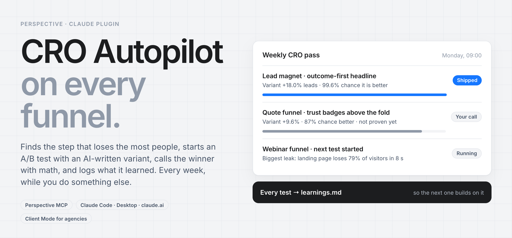
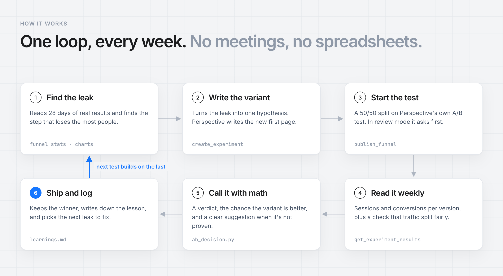
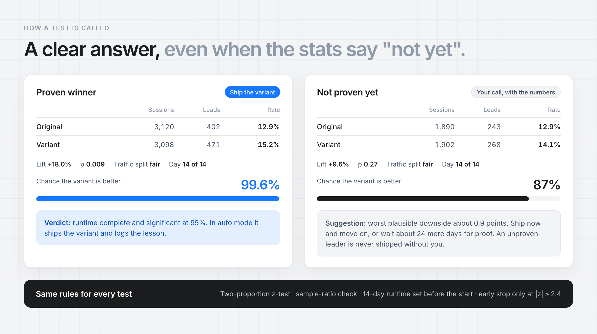
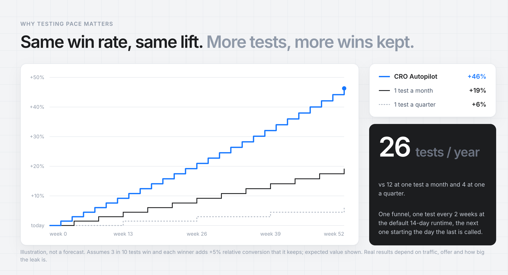
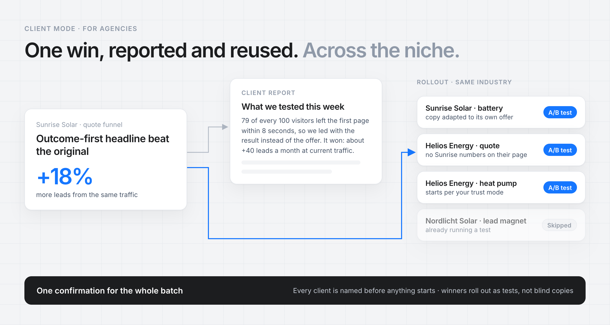

# CRO Autopilot — a Claude plugin and ChatGPT skill for Perspective funnels



CRO Autopilot does the job of a conversion-rate optimizer for your [Perspective](https://www.perspective.co) funnels. Once a week it reads your real results, finds the step that loses the most people, and starts an A/B test with an AI-written variant. It calls the winner with a fixed statistical script, keeps what works, and writes down what it learned, so the next test starts smarter.

You stay in charge. In **review** mode it prepares everything and asks before it starts or ends a test. In **auto** mode it runs the loop on its own and reports what it did. It only ships proven results. An unproven leader is always your call.

## Why use it

- **A test is always running.** Each funnel gets a new test as soon as the last one is called, instead of waiting for someone to find the time.
- **Decisions you can defend.** Every test is called by the same script with the same rules, and you get a plain answer: ship, keep running, or keep the original.
- **Nothing is learned twice.** Every test goes into one log (`learnings.md`). The plugin reads it before designing the next test, so a loser is never retried as-is and a winner on one funnel becomes the first idea for the others.
- **Built for agencies.** Client Mode writes a client-ready report for every decided test and rolls a winner out to the same niche's other funnels as new tests.

## How it works



1. **Find the leak.** It reads the last 28 days of each funnel and finds the step where the most people drop off. How long visitors stay on a page tells it what kind of problem it is: leaving within seconds is a message problem, leaving after a long read is an objection to the offer.
2. **Write the variant.** It turns the leak into one clear hypothesis, and Perspective's AI writes the new version of the first page from it.
3. **Start the test.** The original and the variant each get half the traffic, using Perspective's built-in A/B testing.
4. **Read it weekly.** It pulls sessions and conversions for each version and checks that traffic split the way it should.
5. **Call it with math.** `ab_decision.py` returns a verdict, the chance the variant is better, and a suggestion when the result is not proven yet.
6. **Ship and log.** It ends the test, keeps the winner, writes the lesson to `learnings.md`, and starts on the next leak.

## How a test is called



Every test is decided the same way:

- a two-proportion z-test at 95% confidence,
- a sample-ratio check, so a lopsided traffic split is caught instead of trusted,
- a runtime fixed before the test starts (14 days by default),
- an early stop only for very clear results (|z| ≥ 2.4).

Most tools only tell you "significant" or "not significant". CRO Autopilot also tells you the **chance the variant is better** and the **worst plausible downside**. That makes a test that is "not proven yet" usable: at 87% with a small downside, you can ship and move on, or wait for proof. Those decisions are yours, and the report gives you the numbers to make them.

Perspective's in-app "Confidence" shows how close a test is to an answer. The chance the variant is better shows how likely it is to win. They measure different things, so the report shows both and labels each one.

## Why testing pace matters



Most funnels are tested rarely, because every test needs someone to set it up, check it and call it. CRO Autopilot removes that step. At the default 14-day runtime, one funnel can finish about 26 tests a year. The chart is an illustration, not a forecast: it assumes 3 in 10 tests win and each win adds +5%. Your results depend on traffic, offer and how big the leak is.

## Client Mode, for agencies



Turn on Client Mode during setup and add your clients to `clients.json` (name, industry, workspaces, funnels).

- **A report for every decided test**, written for the client in plain language: what was tested and why, what happened, what it means for their leads, and what is live now. Losing tests are reported too, so the client sees the work behind the wins.
- **Rollout of winners.** `/cro-rollout` takes a winning test to the client's other funnels in the same industry, or across clients if you ask. Each target gets a new A/B test with copy adapted to its own offer, never a copy of another client's page.
- **One confirmation per batch.** Every client is named before anything starts. Funnels that already have a test running are skipped and listed.

## Review or auto

| | Review (default) | Auto |
|---|---|---|
| Finds leaks, designs tests | ✓ | ✓ |
| Starts a test | asks you first | on its own |
| Ships a proven winner | asks you first | on its own, then reports |
| Ships an unproven leader | your call | your call |
| How to turn on | default | you approve it once, in your own words; the approval is saved in `config.json` |

## Install

You need a Perspective account and the **Perspective MCP** connected to Claude: [how to connect the Perspective MCP](https://intercom.help/perspective-funnels/en/articles/15374243-how-to-connect-perspective-mcp-with-claude) (about 2 minutes).

### Claude Code

```
/plugin marketplace add Perspectiveco/perspective-cro-autopilot
/plugin install perspective-cro-autopilot@perspective-cro-autopilot
```

Then start Claude in an empty folder for your CRO work and run `/cro-setup`. The plugin keeps its memory in `.cro-autopilot/` inside that folder: settings, the state of each funnel, the test log and reports.

### Claude desktop app and claude.ai

1. Download [`cro-autopilot.skill`](cro-autopilot.skill) from this repo.
2. Open it in Claude and click **Save skill**, or upload it under **Settings → Capabilities**.
3. Turn on code execution. The skill runs small Python scripts to call each test.
4. Start a chat: *"Set up CRO Autopilot for my Perspective funnels."*

The skill-only install has no slash commands; just describe what you want. On claude.ai, files don't carry over from one chat to the next, so the test log doesn't either. For the weekly loop with a lasting log, use Claude Code.

## Use it in ChatGPT

The same skill runs in ChatGPT. Download [`cro-autopilot-chatgpt.zip`](cro-autopilot-chatgpt.zip) from this repo.

**Use the ChatGPT desktop app with a folder** for the weekly loop. The folder keeps the test log, so each week builds on the last, and the weekly run happens without you. ChatGPT on the web works too, but there you carry the test log from week to week as a file (see below).

You need:
- the **ChatGPT desktop app** (macOS or Windows) and **ChatGPT Work**. Plan on a paid plan (Plus or higher); Free and Go get Work in the desktop app only where OpenAI has rolled it out.
- the **Perspective MCP** connected to ChatGPT: [how to connect the Perspective MCP with ChatGPT](https://intercom.help/perspective-funnels/en/articles/15533402-how-to-connect-perspective-mcp-in-chatgpt). In the desktop app: **Settings → MCP servers → Add server**, name `Perspective`, **Streamable HTTP**, URL `https://api.perspective.co/mcp`, then **Authenticate**. On Business and Enterprise plans, your workspace admin adds it first.
- **Python 3** on your computer. The skill runs small Python scripts to call each test.

Set it up:
1. Make an empty folder for your CRO work, for example `CRO Autopilot`. In the desktop app, create a project and add the folder to it (project menu → **Edit project → Add folder**).
2. Install the skill:
   - **Business, Enterprise or Edu:** **Plugins → Skills → Create → Upload from your computer**, then pick `cro-autopilot-chatgpt.zip`. ChatGPT scans it before it is ready.
   - **Any plan, desktop app:** unzip `cro-autopilot-chatgpt.zip` into `.agents/skills/` inside your CRO folder, so the folder contains `.agents/skills/cro-autopilot/SKILL.md`.
3. Start a Work chat in that project and say: *"Set up CRO Autopilot for my Perspective funnels."* (or type `@` and pick `cro-autopilot`).

There are no slash commands in ChatGPT. Say what you want instead:

| In Claude Code | In ChatGPT, say |
|---|---|
| `/cro-setup` | *"Set up CRO Autopilot"* |
| `/cro-weekly` | *"Run the weekly CRO"* |
| `/cro-report <funnel>` | *"Client report for <funnel>"* |
| `/cro-rollout <winner>` | *"Roll out the <funnel> winner"* |

**Make it weekly.** At the end of setup, say *"Schedule the weekly CRO run every Monday at 9:00 in this project."* ChatGPT creates a scheduled task that runs in your CRO folder. Keep the computer on and the ChatGPT app running at that time. In auto mode nobody needs to be there. In review mode, and whenever ChatGPT holds a Perspective action for your approval, the run report lists what is waiting for you.

**On ChatGPT on the web** (no folder), the skill keeps its settings and test log in one file, `cro-autopilot-memory.zip`, and hands you the new version at the end of every run. Keep it, attach it to next week's chat and say *"Run the weekly CRO"*. A scheduled task on the web can't reach that file, so the skill sets up a weekly reminder instead of an unattended run. Uploading a skill on the web needs a Business, Enterprise or Edu plan.

To rebuild the zip after changing the skill, run `python3 chatgpt/build.py`; it fails if a swapped line changed or Claude-only text is left.

## Commands

| Command | What it does |
|---|---|
| `/cro-setup` | Pick the funnels, choose review or auto, turn Client Mode on or off, then run the first pass |
| `/cro-weekly` | The weekly pass: read running tests, call them, ship winners, start the next tests, update the log |
| `/cro-report <funnel>` | Client Mode report for a funnel's latest decided test |
| `/cro-rollout <winner>` | Roll a winner out to same-industry funnels as new A/B tests |

You can also just ask: *"Is the test done?"*, *"Should we ship it?"*, *"What should we test next?"*, *"What have we learned so far?"*

### Make it weekly

In Claude Code, schedule `/cro-weekly` once a week with `/schedule`, pointed at your CRO folder. In auto mode nobody needs to be there. In review mode the report lists what is waiting for your yes.

## Good to know

- **First page only.** Perspective's A/B tests cover a funnel's first page. Leaks deeper in the funnel are fixed as before/after changes, held to a stricter bar, and always labeled that way.
- **Classic funnels are measure-only.** The MCP has no test tools for classic (non-AI) funnels. The plugin still finds the leak, designs the test and calls it. You make the change and end the test in the Perspective app.
- **Traffic decides the pace.** A funnel with little traffic needs longer than 14 days to prove a +15% change. The plugin tells you how long, rather than calling a test early.
- **Early release.** Reading a running test's results through the MCP is new. If a read fails or looks inconsistent, the plugin skips the verdict and never ends a test on it.

## Guardrails

- Every number comes from your own Perspective data. Missing data is reported as missing, never estimated.
- In review mode, nothing starts, ends or ships without your yes.
- An unproven leader is never shipped without you, in either mode.
- Client data stays with its client: rollouts adapt the copy, and no client's numbers appear on another client's page.
- Nothing is sent to clients. Reports are drafted for you to pass on.

## Repository structure

```
.
├── README.md
├── cro-autopilot.skill                 # installable skill for the Claude desktop app and claude.ai
├── cro-autopilot-chatgpt.zip           # the same skill for ChatGPT (built by chatgpt/build.py)
├── .claude-plugin/marketplace.json     # makes this repo a Claude Code plugin marketplace
├── chatgpt/                            # ChatGPT build: build.py, chatgpt.md (memory, scheduling), openai.yaml
├── assets/                             # images in this README
└── perspective-cro-autopilot/          # the plugin
    ├── .claude-plugin/plugin.json
    ├── .mcp.json                       # Perspective MCP
    ├── commands/                       # /cro-setup /cro-weekly /cro-report /cro-rollout
    └── skills/cro-autopilot/
        ├── SKILL.md                    # the weekly loop, trust modes, report format
        ├── references/                 # data playbook, test design, decision rules, log format, Client Mode
        ├── scripts/                    # ab_decision.py, log_test.py, tally_contacts.py (Python 3, standard library only)
        └── evals/evals.json            # test prompts
```

Built by [Perspective](https://www.perspective.co), the AI funnel platform.
